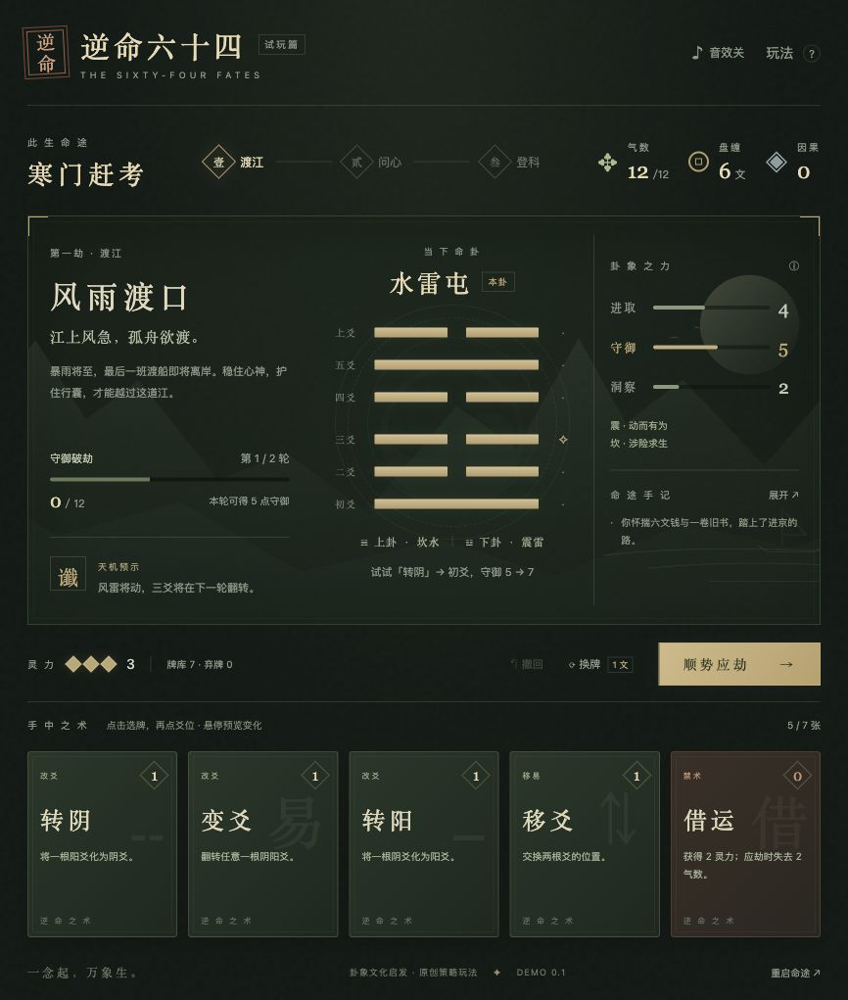

# 逆命六十四 · 寒门赶考

用手牌改写六根阴阳爻，组合六十四卦，在进京赶考途中应对三道命劫。国风策略网页游戏 Demo。



## 本地运行

需要 **Node.js 20 或以上版本**。项目没有第三方依赖，无需执行 `npm install`。

```sh
git clone https://github.com/starWave0225/destiny_master.git
cd destiny_master
npm run dev
```

打开 <http://127.0.0.1:4173/>。修改 `src/` 下的文件后，刷新页面即可看到变化。

如端口已被占用，可执行 `PORT=4180 npm run dev`。

## 玩法

1. 点击手牌，再点击中央亮起的爻位；整卦牌选中后点击「施展此牌」。出牌前可以预览变卦和能力变化。
2. 每轮有 3 灵力。八种基础卦分别提供「进取、守御、洞察」，上下卦能力相加；纯卦的三项能力各增加 1。
3. 点击「顺势应劫」，将当前所需能力计入本劫进度。每劫两轮，累计达到 12 即可破劫。
4. 第一轮结束时，预示中的一根爻会翻转；「定爻」可以挡住这次变化。
5. 未达目标会损失差额一半的气数，向上取整。「借运」能获得 2 灵力，但下次应劫需偿还 2 气数。
6. 途中从三张新术中选择一张加入牌组，依次经历「风雨渡口」「荒寺夜灯」「金榜之前」，抵达不同结局。

开局可以试试 **「转阴」→「初爻」**，让守御从 5 提升到 7。刷新页面会自动恢复本浏览器内的进度，也可以点击「重启命途」重新开始。

## 验证与构建

```sh
npm test
npm run build
npm run preview
```

- `npm test`：验证 64 种卦象、卡牌规则、非法操作、预览、天变、借运、死亡、换牌和手牌上限，并运行 30 局完整策略模拟。
- `npm run build`：生成 `dist/` 静态站点，同时生成包含全部样式和逻辑的 `dist/offline.html`。
- `npm run preview`：在 <http://127.0.0.1:4174/> 预览构建产物。

`dist/` 可以部署到支持静态文件的托管平台。部署时保留文件相对路径，并为 `.mjs` 文件设置 JavaScript MIME 类型。离线版可以直接用系统浏览器打开；部分应用内浏览器不支持本地文件。

## 项目结构

```text
src/
  index.html          游戏页面、玩法说明和弹窗
  style.css           国风牌桌样式与响应式布局
  engine.mjs          卦象、卡牌、牌库、事件与结局规则
  game.mjs            界面交互、变化预览、音效与本地存档
tests/
  engine.test.mjs     规则验证与完整命途模拟
scripts/
  serve.mjs           零依赖本地静态服务器
  build.mjs           静态站点与离线单文件构建
docs/
  demo.jpg            试玩截图
```

界面与规则均在浏览器本地运行，无需后端或账号。卦象与卦名取中华文化意象，能力、卡牌效果和故事为原创游戏设计。
